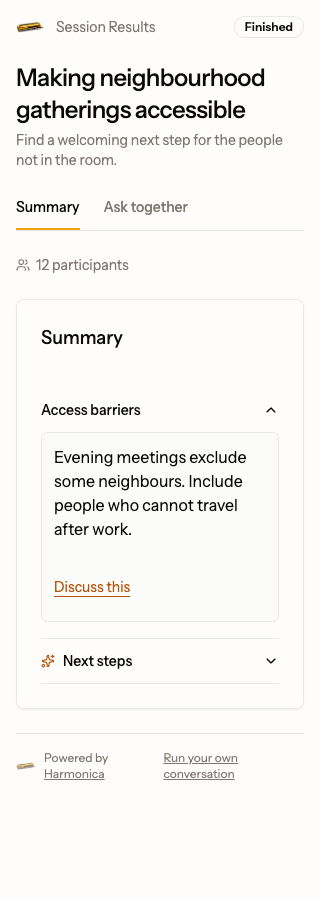

Open the results link your host shared and select **Summary**. Expand a section you want to discuss. Choose **Discuss this** beneath a passage to open its related questions in **Ask together**.

*Example from a synthetic session about neighbourhood gatherings.*

## Ask a question or join a discussion

Read the related questions first. Select a question to read its replies, or select **New question** to start one. Check who can see your post, write your question or reply, then select **Post**. If you only have reading access, ask your host for the session’s participation route.

Use **View in summary** on a linked question to return to its source passage. You can come back to the discussion later.

## Ask Monica

When Monica is available, select **Also ask Monica** before posting. Open a reference in the answer to inspect the supporting evidence. If Monica is paused, eligible participants can still post questions and human replies while discussion is enabled.

## Set up a session as its host

If you own the session, open its settings and enable shared discussion. Share the participation link with the people you want to invite to post.

Encountering supports sessions created without a template and the supported versions of Retrospective and After Action Review. For Stakeholder Analysis, SWOT Analysis and Community Deliberation, open the settings after a standalone session has produced its summary. These three methods support discussion of the results in standalone sessions only.

Only the session’s direct billing owner can enable Monica answers. Settings show whether model usage is included with your Harmonica coverage or billed directly by your provider through your API key. Under covered usage you can set an optional session budget for estimated AI usage in USD. If your session already has a request limit, you can keep it or switch to covered usage.
